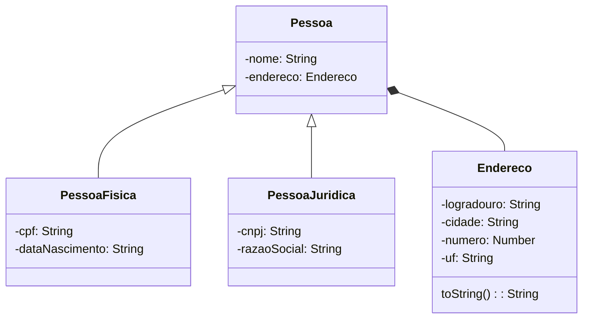

# Appful - Cadastro de Pessoas

Resolução da atividade avaliativa da disciplina de **Programação Orientada a Objetos (POO)**, parte do curso de **Desenvolvimento Mobile com Flutter SENAI (2026)**.

## Domínio



## Regras 

- o nome deve ter ao menos 3 caracteres;
- o CPF deve ter 11 dígitos e o CNPJ, 14 dígitos (a entrada pode conter pontos, traço e barra, que devem ser desconsiderados);
- a data de nascimento deve ser uma data válida e não pode estar no futuro;
- a razão social é obrigatória.


## Testes de cenários


### Cria Pessoa Jurídica Válida
```javascript
  criarPessoaJuridicaValida() {
    const endereco = new Endereco("Rua A", 123, "Cidade B", "SP");
    const novaPessoa = new PessoaJuridica(
      "Empresa X",
      endereco,
      "12.345.678/0001-90",
      "Razão Social X",
    );
    console.log("----------------------------------------------");
    console.log("Pessoa jurídica criada com sucesso!");
    console.log("Nome:", novaPessoa.nome);
    console.log("Endereço:", novaPessoa.endereco.toString());
    console.log("CNPJ:", novaPessoa.cnpj);
    console.log("Razão Social:", novaPessoa.razaoSocial);
    console.log("----------------------------------------------");
    return novaPessoa;
  }
```
- Saída

```bash
----------------------------------------------------------
Criar pessoa jurídica válida:
----------------------------------------------
Pessoa jurídica criada com sucesso!
Nome: Empresa X
Endereço: Rua A, 123 - Cidade B/SP
CNPJ: 12.345.678/0001-90
Razão Social: Razão Social X
----------------------------------------------
```

### Cria Pessoa Física Válida

```javascript
  criarPessoaFisicaValida() {
    const endereco = new Endereco("Rua A", 123, "Cidade B", "SP");
    const novaPessoa = new PessoaFisica(
      "João da Silva",
      endereco,
      "123.456.789-00",
      "01-01-1990",
    );

    console.log("----------------------------------------------");
    console.log("Pessoa física criada com sucesso!");
    console.log("Nome:", novaPessoa.nome);
    console.log("Endereço:", novaPessoa.endereco.toString());
    console.log("CPF:", novaPessoa.cpf);
    console.log("Data de Nascimento:", novaPessoa.dataNascimento);
    console.log("----------------------------------------------");
    return novaPessoa;
  }
```

- Saída

```bash
----------------------------------------------------------
Criar pessoa física válida:
----------------------------------------------
Pessoa física criada com sucesso!
Nome: João da Silva
Endereço: Rua A, 123 - Cidade B/SP
CPF: 123.456.789-00
Data de Nascimento: 01-01-1990
----------------------------------------------
```

### Cria Pessoa Física com Data de Nascimento Inválida

```javascript
  criarPessoaFisicaDataNascimentoInvalida() {
    try {
      const dataFutura = new Date();
      dataFutura.setFullYear(dataFutura.getFullYear() + 1);
      const novaData = dataFutura
        .toLocaleDateString("pt-BR")
        .replaceAll("/", "-");

      const endereco = new Endereco("Rua A", 123, "Cidade B", "SP");
      const novaPessoa = new PessoaFisica(
        "João da Silva",
        endereco,
        "123.456.789-00",
        novaData,
      );
      return novaPessoa;
    } catch (error) {
      console.log("Erro ao criar pessoa física:", error.message);
      console.log("----------------------------------------------");
      return error;
    }
  }
```

- Saída

```bash
----------------------------------------------------------
Criar pessoa física com data de nascimento inválida:
Erro ao criar pessoa física: Data de nascimento não pode ser maior que a data atual.
----------------------------------------------
```

### Cria Pessoa Física com CPF inválido

```javascript
  criarPessoaFisicaCpfInvalido() {
    try {
      const endereco = new Endereco("Rua A", 123, "Cidade B", "SP");
      const novaPessoa = new PessoaFisica(
        "João da Silva",
        endereco,
        "123.456.78-00",
        "01-01-1990",
      );
      return novaPessoa;
    } catch (error) {
      console.log("Erro ao criar pessoa física:", error.message);
      console.log("----------------------------------------------");
      return error;
    }
  }
```

- Saída

```bash
----------------------------------------------------------
Criar pessoa física com CPF inválido:
Erro ao criar pessoa física: CPF inválido.
```

### Cria Pessoa Jurídica com CNPJ inválido

```javascript
  criarPessoaJuridicaCnpjInvalido() {
    try {
      const endereco = new Endereco("Rua A", 123, "Cidade B", "SP");
      const novaPessoa = new PessoaJuridica(
        "Empresa X",
        endereco,
        "12.345.67/0001-9",
        "Razão Social X",
      );
      return novaPessoa;
    } catch (error) {
      console.log("Erro ao criar pessoa jurídica:", error.message);
      console.log("----------------------------------------------");
      return error;
    }
  }
```

- Saída

```bash
----------------------------------------------------------
Criar pessoa jurídica com CNPJ inválido:
Erro ao criar pessoa jurídica: CNPJ inválido.
----------------------------------------------
```


### Cria Pessoa Física com nome com mais que 50 caracteres

```javascript
  criarPessoaFisicaNomeMaiorQueCinquentaCaracteres() {
    try {
      const endereco = new Endereco("Rua A", 123, "Cidade B", "SP");
      const nomeLongo =
        "Nooooooooooooooooooooooooooooommmmmmmmmeeeeeeeeeeeeeeeeelooooooooooooooooonnnnnnnnnnnnnnnnnnnngoooooooooooooooooooooooooooooooooooooooooooooooo";

      const novaPessoa = new PessoaFisica(
        nomeLongo,
        endereco,
        "123.456.789-00",
        "01-01-1990",
      );
      return novaPessoa;
    } catch (error) {
      console.log("Erro ao criar pessoa física:", error.message);
      console.log("----------------------------------------------");
      return error;
    }
  }
```
- Saída

```bash
----------------------------------------------------------
Criar pessoa física com nome maior que 50 caracteres:
Erro ao criar pessoa física: Nome deve ter entre 3 e 50 caracteres.
----------------------------------------------
```

### Cria Pessoa Física com nome com menos de 3 caracteres

```javascript
  criarPessoaFisicaNomeMenorQueTresCaracteres() {
    try {
      const endereco = new Endereco("Rua A", 123, "Cidade B", "SP");

      const novaPessoa = new PessoaFisica(
        "Vi",
        endereco,
        "123.456.789-00",
        "01-01-1990",
      );
      return novaPessoa;
    } catch (error) {
      console.log("Erro ao criar pessoa física:", error.message);
      console.log("----------------------------------------------");
      return error;
    }
  }
```
- Saída

```bash
----------------------------------------------------------
Criar pessoa física com nome menor que 3 caracteres:
Erro ao criar pessoa física: Nome deve ter entre 3 e 50 caracteres.
----------------------------------------------
```
## Como executar

### Pré-requisitos
Certifique-se de ter o [Node.js](https://nodejs.org/) instalado.

###  Instalação

1. Clone o repositório ou baixe os arquivos.
2. Abra o terminal na pasta `src` do projeto.
3. Execute o comando: 
```bash
    node App.js
```